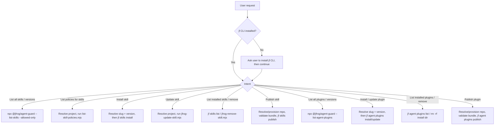

# JFrog AI Catalog

Discover, install, and manage agent skills and agent plugins from the JFrog AI
Catalog (Artifactory skills/plugins repositories), and publish your own back to
it, all through the JFrog CLI (`jf skills`, `jf agent plugins`) and the JFrog
Agent Guard.

## Choose a reference file

Pick the row matching the user's intent and read that reference file.

| Intent | Read |
|--------|------|
| "What skills are available?" / browse the catalog / list versions / search by name | [references/discovering-skills.md](references/discovering-skills.md) |
| List the AI Catalog governance policies that apply to skills in a project (not MCP servers, not Xray/curation — see `listing-policies.md`'s own disambiguation) | [references/listing-policies.md](references/listing-policies.md) |
| Install a skill with an explicitly resolved version and repo, update a skill, or handle a blocked download | [references/installing-skills.md](references/installing-skills.md) |
| "What's installed?" / remove an installed skill | [references/managing-installed-skills.md](references/managing-installed-skills.md) |
| Publish / upload / release a skill to the catalog | [references/publishing-skills.md](references/publishing-skills.md) |
| "What plugins are available?" / browse the plugin catalog / list plugin versions / search plugins | [references/discovering-plugins.md](references/discovering-plugins.md) |
| Install or update a plugin (latest or a pinned version) | [references/installing-plugins.md](references/installing-plugins.md) |
| "What plugins are installed?" / remove an installed plugin | [references/managing-installed-plugins.md](references/managing-installed-plugins.md) |
| Publish / upload / release a plugin to the catalog | [references/publishing-plugins.md](references/publishing-plugins.md) |

## Prerequisites

- **Read the base `jfrog` skill first.** [`../jfrog/SKILL.md`](../jfrog/SKILL.md)
  owns the shared guards this skill depends on, so this skill does **not** repeat
  them — follow them there:
  - The [environment check](../jfrog/SKILL.md#environment-check) — confirm `jf`
    is installed before the first `jf` call, and install it if missing.
  - The [server selection rules](../jfrog/SKILL.md#server-selection-rules-mandatory)
    — pass `--server-id <SID>` after the subcommand on every `jf` call, and use
    one server per request. `<SID>` comes from the next bullet.
  - The stop-on-error rule — on any `jf` failure, stop and never switch servers.

  One addition specific to this skill: never `cat` or parse
  `~/.jfrog/jfrog-cli.conf.v6` (it can hold access tokens); list servers only
  with `jf config show`, which redacts secrets.
- **The AI Governance server and project.** The AI Governance server is the
  JFrog Platform server (a jf CLI server ID) that governs the user's AI
  assets: its AI Catalog lists the skills, plugins and MCP servers they may
  use, and Agent Guard, where the organization has turned it on, enforces
  that. The AI Governance project is the JFrog project on that server that
  scopes the AI Catalog: which skills, plugins and MCP servers the user sees
  and may install. Both are saved in `~/.jfrog/setup.json`, separately from
  the jf CLI default server; the AI Governance server can be the same server
  as that default or a different one. The user chooses both in
  `/jfrog-init`; another skill saves one only when it is missing or unclear
  and the user answers that skill's question.
  Read and change the file only through `jfrog-ai-governance-config.mjs`.

  In this skill, flows that need a project (listed below) use the AI
  Governance server and project. Flows that need a server but no project use
  the AI Governance server; only when no AI Governance server is saved do they
  use the jf CLI default server instead. Read both once, before the first
  `jf` or Agent Guard call:

  ```bash
  node <skill_path>/scripts/jfrog-ai-governance-config.mjs get
  ```

  `<SID>` is the AI Governance server ID that `get` returned (`serverId`), and
  `<PROJECT>` is its AI Governance project key (`project`). Flows that need
  `<PROJECT>`: browsing or searching skills and plugins, listing versions,
  installing (the repository comes from the versions listing), updating a
  skill (only from a repository still in the project's `--allowed-only`
  listing), listing policies, and publishing with no repository named.
  Removing an installed skill or plugin needs neither. All other flows need
  only `<SID>`.
  Then act on `status`:
  - `ok` — continue with `<SID>` and `<PROJECT>`.
  - `no_project` — the server is set, the project is not (e.g. the user told
    `/jfrog-init` they don't use AI Catalog). When the flow needs `<PROJECT>`,
    ask: "Which AI Governance project on `<host>` should I use? I need its
    project key." (`<host>` is the host of the `jpdUrl` that `get` returned.)
    The answer is `<PROJECT>` from now on. Save it by running
    `node <skill_path>/scripts/jfrog-ai-governance-config.mjs set "<SID>" "<PROJECT>"`.
    Never take the key from `JF_PROJECT` or other env vars; they are no longer
    used (`get` notes them on stderr).
  - `ambiguous` — several servers are saved (e.g. set up for more than one
    JFrog platform) and none is marked as the AI Governance server. Run
    `node <skill_path>/scripts/jfrog-ai-governance-config.mjs list`, show the
    user each `serverId` with its `jpdUrl`, and ask: "Which of these is your AI
    Governance server?" Wait for the answer, save it with
    `node <skill_path>/scripts/jfrog-ai-governance-config.mjs set "<SID>"`,
    and run `get` again.
  - `missing` or `corrupt` — AI Governance is not set up. If the flow needs
    `<PROJECT>`, reply with this exact line and stop:
    "AI Governance isn't set up. Run `/jfrog-init` to set it up."
    When publishing, reply instead: "AI Governance isn't set up. Run
    `/jfrog-init` to set it up, or tell me a repository to publish to."
    Otherwise `<SID>` is the jf CLI default server:

    ```bash
    jf config show 2>/dev/null \
      | awk '/^Server ID:/{id=$NF} /^Default:[[:space:]]*true/{print id; exit}'
    # stdout: the default server-id; if empty, stop and ask which server to use
    ```

    Then say once: "Using `<SID>` from your jf CLI config."

  If a `jfrog-ai-governance-config.mjs set` command above fails, show the
  user its error. For a rejected project key, ask once more; otherwise, or if
  the second key is rejected too, ask the user to run `/jfrog-init` to repair
  the AI Governance setup, and stop.

  There is no non-admin way to look up or validate project keys (the
  `/access/api/v1/projects` list endpoint needs admin), so you cannot
  silently correct a display name to a key. If the project key looks like a
  display name (spaces, mixed case) rather than a short slug, ask the
  user to confirm the project **key** specifically. Never assume
  `default`, never invent one.
- **Agent Guard registry.** Catalog discovery and repo provisioning run through
  `npx --yes @jfrog/agent-guard`. `<REGISTRY_URL>` is the npm registry that
  provides the `@jfrog/agent-guard` package itself: use `JFROG_AGENT_GUARD_REPO`
  if set, otherwise
  `https://releases.jfrog.io/artifactory/api/npm/coding-agents-npm/`. Always pass
  the same `<SID>` to Agent Guard as `--server "<SID>"` so it targets the same
  server as your `jf` calls.
- **Bundle manifests differ by type.** Skill bundles require `SKILL.md`
  in the bundle root; plugin bundles require `plugin.json`. Validate the
  correct file before installing or publishing.

## Workflow overview



## Gotchas

Catalog-specific rules only. The shared `jf` guards — single server per request,
stop-on-error, and cautious mutation — live in the base
[`jfrog` skill](../jfrog/SKILL.md); follow those too. Flow-specific rules live in
the reference files above.

- **Which operations mutate**: install and list are read-mostly; remove, registry
  delete, and publish mutate state — the base skill's cautious-mutation rule
  applies to those three.
- **Session pickup**: installs, updates, and removals usually take effect only at
  the next agent session start, so tell the user to restart.
- **Don't leak the plumbing**: present skills/versions/repos to the user, never
  the `npx`/Agent Guard commands, `--registry`, flags, or cursors. Run follow-ups
  yourself. Discuss catalog filtering only when the user asks about missing or
  blocked results; follow the refusal in `discovering-skills.md`.
- **Skill discovery is always policy-scoped**: every skill and skill-version
  listing must follow `discovering-skills.md`. Never weaken that listing path,
  including for audit, blocked-content, or named-repository requests. Each
  `locations[]` entry from `--list-skill-versions` also carries its own
  `allowStatus`, since a repo's governance status is a per-repo fact, never a
  per-version one (MLAI-1309) — see `discovering-skills.md` and
  `installing-skills.md`.
- **Use the response templates verbatim**: where a reference file gives a "reply
  using this exact template" block, fill the placeholders and send exactly that,
  with the same wording every time and no extra preamble or commentary.
- **Plugins have no Xray support**: skip all Xray-related handling (no 403
  gating on download, no inline scan on publish, no `--skip-scan` flag) when
  performing any `jf agent plugins` operation.
